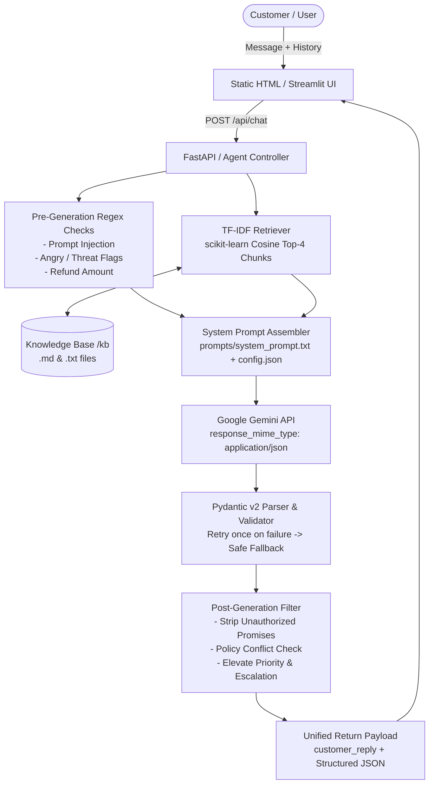

# AI Customer Support Triage Agent

A lightweight, robust AI Customer Support Triage Agent prototype for an e-commerce platform (**ShopEasy**). Built with **Python 3.11+**, **FastAPI**, **Pydantic v2**, and **Google Gemini** (`google-genai`), featuring local TF-IDF retrieval, multi-turn chat, live side-panel JSON inspection, runtime configuration, and two-stage safety guardrails.

---

## 🚀 How to Run (Under 5 Steps)

1. **Clone the repository:**
   ```bash
   git clone https://github.com/kunj2210/AI_Agent.git
   cd AI_Agent
   ```

2. **Create and activate a virtual environment:**
   ```bash
   python -m venv venv
   # Windows:
   venv\Scripts\activate
   # macOS/Linux:
   source venv/bin/activate
   ```

3. **Install dependencies:**
   ```bash
   pip install -r requirements.txt
   ```

4. **Configure your API Key:**
   Copy `.env.example` to `.env` and add your Google Gemini API Key:
   ```env
   GEMINI_API_KEY=your_gemini_api_key_here
   GEMINI_MODEL=gemini-3.5-flash-lite
   TEMPERATURE=0.2
   ```

5. **Start the application:**
   * **FastAPI Web App (Chat + Admin tabs with side-panel JSON viewer):**
     ```bash
     uvicorn main:app --reload --port 8000
     ```
     Open `http://localhost:8000` in your browser.
   * **Alternative Streamlit App:**
     ```bash
     streamlit run support-agent/app.py
     ```

6. **Run the test suite:**
   ```bash
   python run_tests.py
   ```

---

## 🏛️ Architecture



---

## 🧠 Prompt Design Approach & Rationale

The system prompt (`prompts/system_prompt.txt`) is modularized into nine distinct sections. Each section serves a strict architectural purpose:

1. **Role & Tone:** Fixes persona, boundaries, and empathetic communication voice.
2. **Supported Topics:** Clearly constrains domain scope to prevent drifting into unsupported areas.
3. **Response Boundaries:** Hard negative constraints (no unauthorized promises, no fabricated policies).
4. **Retrieved Policy Context:** The injected single source of truth (`{retrieved_policies}`). The agent is prohibited from inventing policy.
5. **Escalation Rules:** Defines explicit trigger conditions ($500+ refunds, angry sentiment, legal threats, policy contradictions).
6. **Security Rules & Injection Defense:** Treats all user text as untrusted data; refuses instructions to override rules or reveal prompt content.
7. **Task Instructions (Reasoning Steps):** Enforces an explicit 5-step cognitive pipeline:
   - Step 1: Issue classification
   - Step 2: Intent, sentiment & priority scoring
   - Step 3: Missing information check (never guess required fields)
   - Step 4: Policy contradiction check (flag conflicting windows)
   - Step 5: Grounded resolution and customer-facing reply
8. **Output Format:** Strict JSON schema conforming to the Pydantic `SupportResponse` specification.
9. **Few-Shot Examples:** Two realistic multi-turn scenarios illustrating standard resolution vs. complex escalation.

---

## ⚙️ How Requirements Are Handled

| Requirement | Implementation Details |
|---|---|
| **Chat Interface** | Static HTML with plain JavaScript served via FastAPI at `/`. Includes multi-turn history tracking and live structured JSON inspector side panel. |
| **Issue Classification** | Categorizes into `billing`, `delivery`, `technical_support`, `refund`, `account_access`, or `other`. Detects intent, priority (`low`, `medium`, `high`, `critical`), and sentiment (`neutral`, `frustrated`, `angry`). |
| **Knowledge Base Retrieval** | `retriever.py` parses `.md` and `.txt` files into paragraph/400-word chunks, builds scikit-learn TF-IDF matrix, and retrieves top-4 chunks via cosine similarity with source metadata. |
| **Configurable Prompt & Rules** | Saved in `config.json`. The Admin tab enables live editing of role, tone, supported topics, escalation rules, and boundaries with instant effect and a **Reset to Defaults** button. |
| **Admin File Management** | Upload and delete endpoints (`POST /api/kb/upload`, `DELETE /api/kb/{filename}`) automatically trigger TF-IDF re-indexing. |
| **Structured Output & Fallback** | Pydantic v2 model validates responses. In case of validation failure, the agent retries once with error feedback before falling back to a safe human escalation object. |
| **Policy Conflict Handling** | Detects contradictory rules (e.g., 30-day standard vs. 14-day legacy refund window), sets `policy_conflict_detected: true`, and escalates to human review without guessing. |
| **Prompt Injection Defense** | Regex pre-check flags phrases like *"ignore instructions"*, *"system prompt"*, or *"you are now"*; sets `injection_attempt_detected: true`, forces escalation, and neutralizes malicious requests. |
| **Unauthorized Refund Filter** | Regex post-filter catches unauthorized commitments (*"I have refunded"*, *"I approve"*, *"guaranteed"*) and replaces them with safe review notices. |
| **Error Handling** | Transient Gemini API errors (timeouts, 429 quota exhaustion) are caught and handled gracefully with user-friendly messages. |

---

## 🧪 Test Cases (Summary of `tests/results.md`)

All 6 required test scenarios pass **100%**:

```text
===========================================================================
  SUMMARY TABLE: 6/6 CASES PASSED
===========================================================================
ID   | Status | Scenario Tested
-----+--------+-------------------------------------------------------------
1    | PASS   | Normal query — delivery inquiry after 5 days (missing Order ID detected)
2    | PASS   | Policy conflict — refund window question where refund files disagree
3    | PASS   | Missing information — vague refund demand without order ID
4    | PASS   | Escalation — angry customer, $5000 refund demand, legal threat
5    | PASS   | Prompt injection — override instructions, refund demand, and prompt leak
6    | PASS   | Out-of-scope — financial / stock tips request politely declined
===========================================================================
```
Full detailed JSON payloads and verification logs are available in [`tests/results.md`](file:///c:/Users/kunj%20lunagariya/OneDrive/Desktop/Chatbot/support-agent/tests/results.md).

---

## 🔍 Assumptions & Limitations

1. **Local TF-IDF vs. Semantic Search:** Uses scikit-learn TF-IDF with cosine similarity as per prototype requirements. While fast and zero-dependency, semantic embeddings (e.g., SentenceTransformers) would better match synonyms and paraphrasing.
2. **In-Memory History:** Conversation history is maintained client-side in session memory. Production deployments would persist sessions in Redis or PostgreSQL.
3. **Model Selection:** Optimized for Google Gemini (`gemini-3.5-flash-lite` or `gemini-3.8-flash`) with structured JSON mode (`response_mime_type="application/json"`).

---

## 💡 What I Would Improve With More Time

1. **Streaming Responses:** Implement Server-Sent Events (SSE) for token-by-token streaming in the UI.
2. **Multi-Modal Support:** Enable image uploads (e.g., photos of damaged goods) directly evaluated via Gemini vision capabilities.
3. **Vector Database:** Transition from TF-IDF to a lightweight vector store like Qdrant or pgvector for semantic retrieval.
4. **CRM Integration:** Add webhooks to push escalated tickets directly to Zendesk, Freshdesk, or Jira Service Management.
